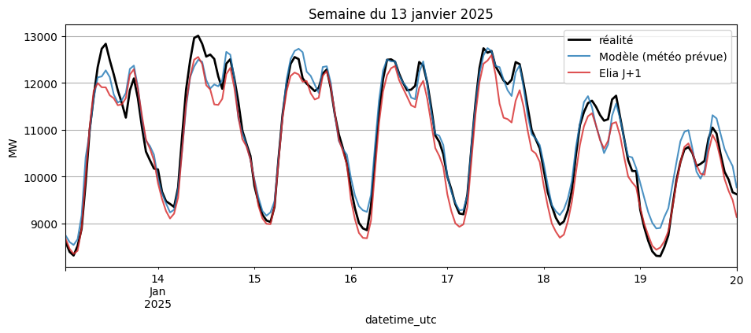
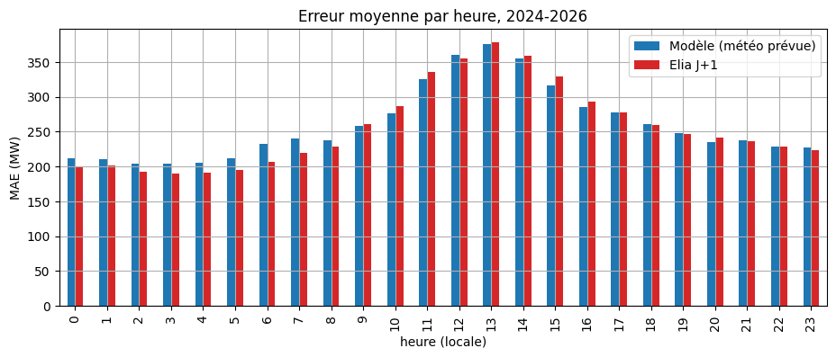

# Prévision J+1 de la consommation électrique belge

Pipeline de données et modèle de machine learning qui prévoient, la veille, la consommation électrique
de la Belgique heure par heure, puis comparent cette prévision à celle publiée par Elia, le gestionnaire
du réseau de transport.

**Résultat** : sur 2024-2026 (24 456 heures), le modèle fait presque jeu égal avec la prévision officielle d'Elia.

| Prévision J+1 | MAE (MW) | MAPE |
|---|---|---|
| Naïve (même heure 7 jours avant) | 428 | 4,6 % |
| **Ce modèle** (météo prévue la veille) | **259** | **2,8 %** |
| **Elia** (prévision officielle) | **256** | **2,8 %** |



## Ce que fait le projet

```
opendata.elia.be ──┐
                   ├─► SQLite (data/elia.db) ─► variables ─► gradient boosting ─► table predictions ─► tableau de bord
open-meteo.com ────┘
```

1. **Ingestion** (`src/ingest.py`, `src/ingest_weather.py`)
   - Consommation totale belge et prévision J+1 d'Elia, au quart d'heure depuis 2015 (jeu Elia `ods001`, ~416 000 lignes).
   - Température et rayonnement solaire horaires, moyenne de 5 villes belges (Open-Meteo) :
     météo **observée** depuis 2015 et météo **prévue la veille** depuis 2024.
   - Stockage dans SQLite, avec clé primaire, upsert (relance sans doublon) et chargement incrémental.
2. **Exploration** (`notebooks/01_exploration.ipynb`) : tendance, cycles annuel, hebdomadaire et journalier,
   jours fériés, autocorrélation, erreur d'Elia par heure.
3. **Modèle** (`src/features.py`, `notebooks/02_model.ipynb`, `src/train.py`)
   - Gradient boosting (`HistGradientBoostingRegressor`, scikit-learn) sur 10 variables :
     heure, jour de la semaine, jour de l'année, jour férié, température, température moyenne sur 24 h,
     degrés de chauffage, rayonnement solaire, consommation 48 h et 7 jours avant.
   - Entraînement 2016-2023 (sans le premier confinement), test du 21/01/2024 au 04/11/2026.
4. **Tableau de bord** (`app.py`, Streamlit) : prévisions et réalité sur une période au choix, MAE/MAPE,
   erreur par heure et par mois.

## Choix de méthode

- **Pas de fuite d'information.** Chaque variable est connue la veille à midi : consommation passée de 48 h et
  plus, calendrier, et **prévision** météo de la veille sur la période de test, pas la météo réelle.
  Avec la météo réelle, le modèle gagnerait seulement 7 MW : l'erreur restante vient d'ailleurs.
- **Découpage temporel.** On entraîne sur le passé et on teste sur la suite, jamais de mélange aléatoire.
- **Heures en UTC dans la base**, converties en heure belge seulement pour le calendrier : pas d'heure
  dupliquée ou manquante aux changements d'heure.

## Ce qu'on apprend

- La consommation d'il y a 7 jours et de 48 h, le jour de la semaine et l'heure portent l'essentiel de l'information ;
  la météo vient ensuite.
- Le modèle bat Elia en milieu de journée (10 h-16 h), là où l'erreur d'Elia est la plus forte, probablement à cause
  du solaire non mesuré chez les particuliers ; Elia reste meilleur la nuit.



## Lancer le projet

Prérequis : Python 3.10 ou plus.

```bash
git clone https://github.com/MarwaneHanma/elia-forecast.git
cd elia-forecast
python -m venv .venv
.venv\Scripts\python -m pip install -r requirements.txt   # Windows ; sous Linux/macOS : .venv/bin/python

.venv\Scripts\python src\ingest.py           # consommation Elia (1 à 2 min la première fois)
.venv\Scripts\python src\ingest_weather.py   # météo
.venv\Scripts\python src\train.py            # entraînement et prévisions
.venv\Scripts\streamlit run app.py           # tableau de bord sur http://localhost:8501
```

Les scripts d'ingestion peuvent être relancés chaque jour : ils ne téléchargent que les jours récents.

## Structure

```
├── app.py                     tableau de bord Streamlit
├── src/
│   ├── ingest.py              Elia -> SQLite
│   ├── ingest_weather.py      Open-Meteo -> SQLite
│   ├── features.py            construction des variables
│   └── train.py               entraînement et écriture des prévisions
├── notebooks/
│   ├── 01_exploration.ipynb
│   └── 02_model.ipynb
├── docs/                      images du README
└── data/                      base SQLite (non versionnée, recréée par les scripts)
```

## Limites et pistes

- La météo « prévue la veille » d'Open-Meteo a été émise 24 h avant chaque heure, un peu plus tard que midi
  la veille pour les heures du soir.
- Pas encore de variables pour les vacances scolaires et les ponts.
- Prévision du lendemain en direct (météo prévue du jour) et planification quotidienne des scripts.
- Passage à PostgreSQL ou à Spark (Databricks) pour des volumes plus grands.

## Sources des données

- [Elia Open Data](https://opendata.elia.be) : jeu `ods001`, consommation totale mesurée et prévue sur le réseau belge.
- [Open-Meteo](https://open-meteo.com) : API Historical Weather (réanalyse ERA5) et Previous Runs (CC BY 4.0).

---

Marwane Yaakoub, ingénieur civil électromécanicien (ULB-VUB), master de spécialisation Data Science & Big Data (ULB).
